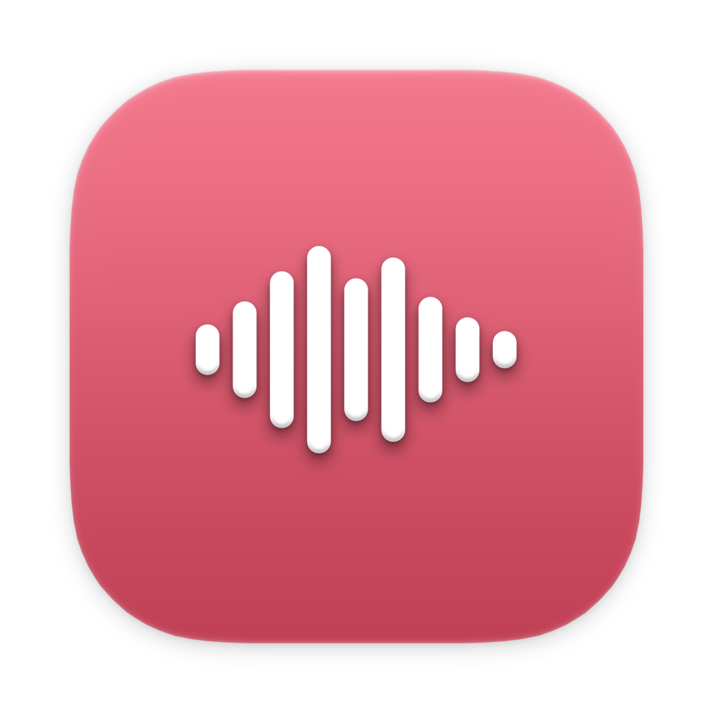
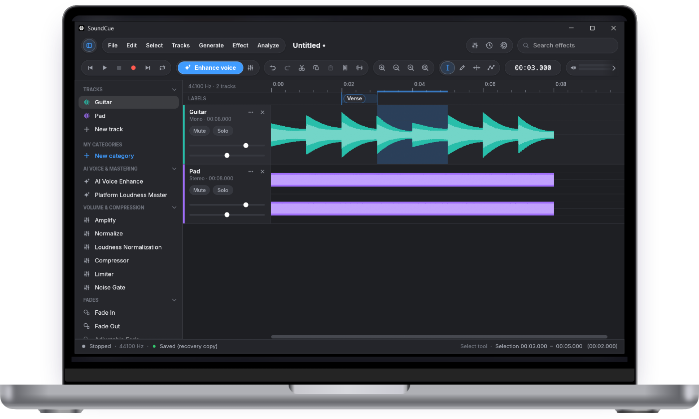
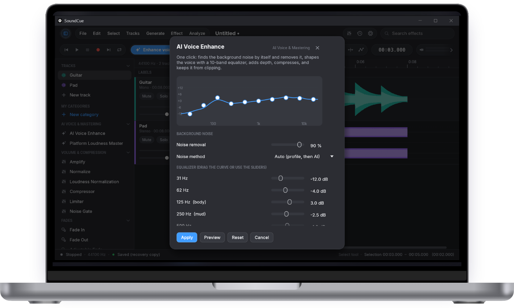
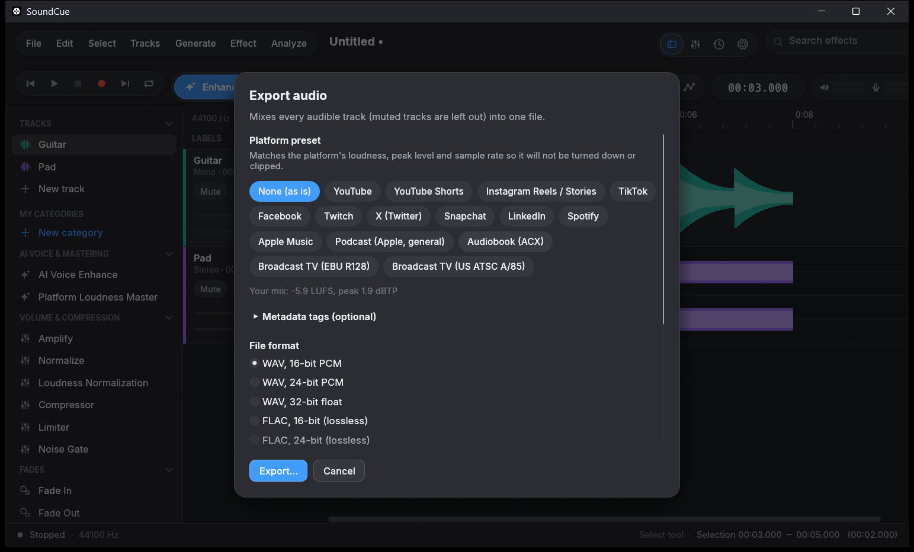
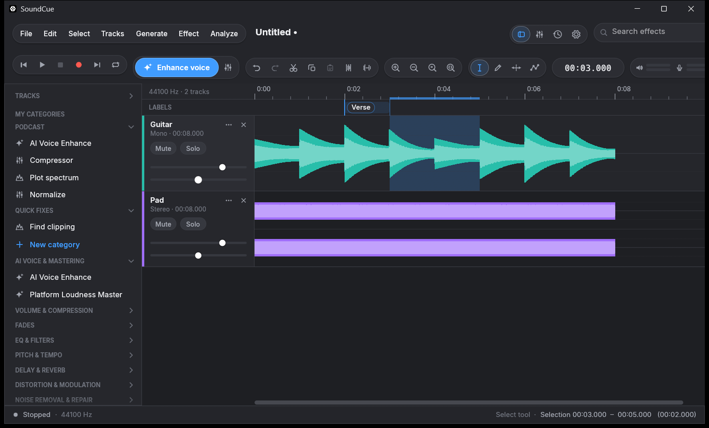
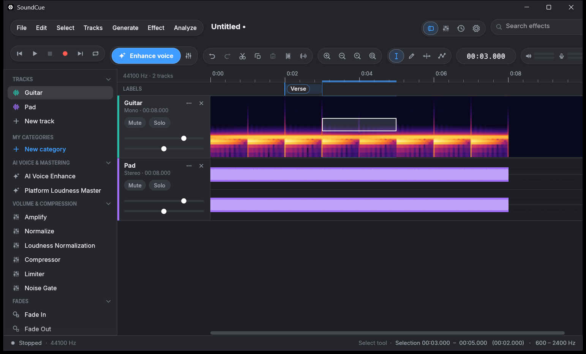
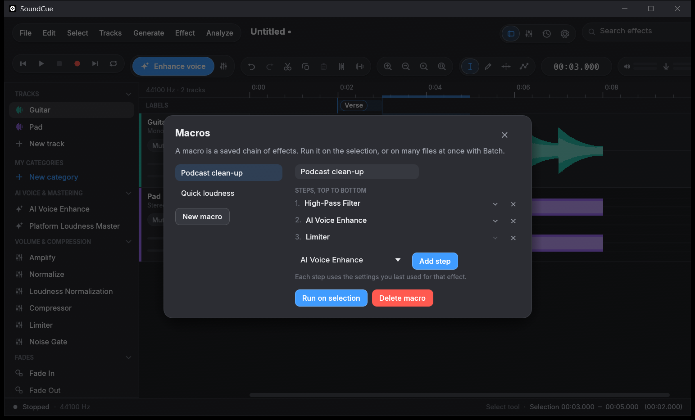
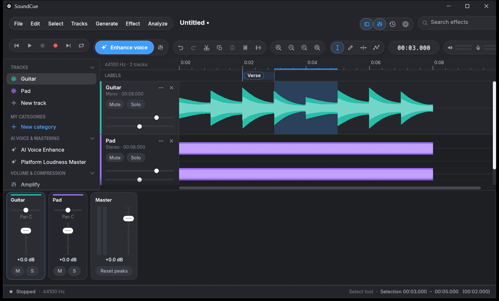
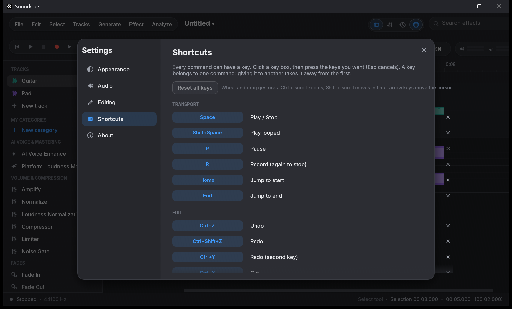

<p align="center">
  
</p>

<h1 align="center">SoundCue</h1>

<p align="center">
  A fast multitrack audio editor written in Rust, for <b>Windows</b>, <b>iPad</b> and <b>iPhone</b>.<br>
  Record, edit and mix audio with one-click AI voice enhancement and ready-made export presets for YouTube, Instagram, TikTok and more.
</p>

<p align="center">
  <a href="CHANGELOG.md">Changelog</a> ·
  <a href="https://github.com/gadgetcue/soundcue/releases">All releases</a>
</p>

<p align="center">
  
</p>

## Highlights

### One-click AI Voice Enhance
Press **Enhance voice** and SoundCue finds the background noise by itself (from the quietest speech-free stretch of your clip, with the RNNoise neural suppressor as a fallback), shapes the voice with a 10-band equalizer you can drag, adds warmth and depth, de-esses, compresses, and finishes with a limiter and true-peak safety so it never clips. Every stage has its controls in the settings next to the button.

<p align="center">
  
</p>

### Export presets for every platform
Pick a platform and SoundCue sets the loudness (LUFS), true-peak ceiling and sample rate for you: YouTube, YouTube Shorts, Instagram, TikTok, Facebook, Twitch, X, Snapchat, LinkedIn, Spotify, Apple Music, podcasts, audiobooks (ACX) and broadcast TV (EBU R128, ATSC A/85). The dialog shows each platform's rules and what your mix measures now.



### Your own sidebar categories
Drag any effect or analysis tool into categories you create. Rename, reorder, collapse and delete them; everything is remembered. On touch screens, press and hold, then drag.



### More
- **Multitrack editing** with unlimited undo, cut / copy / paste, trim, silence, split, duplicate, labels, zoom and a time ruler
- **41 effects and generators**: amplify, normalize, loudness (LUFS), compressor, limiter, noise gate, fades, EQ, filters, speed / tempo / pitch, echo, reverb, distortion, phaser, tremolo, wah-wah, noise reduction (with profile), click removal, clip fix, vocal reduction, reverse, truncate silence, tone, chirp, noise, DTMF, rhythm track, pluck and more
- **Spectrogram view** with spectral selection: drag a box over time and frequency, then delete or keep that band

  
- **Macros and batch processing**: save a chain of effects, run it on the selection or on a whole folder of files

  
- **Mixer board** with faders, pan, mute, solo and a master meter

  
- **Envelope tool** to draw volume curves, plus **sync-lock** to keep tracks aligned
- **Analysis**: spectrum plot, loudness and levels (peak, RMS, LUFS), find clipping, label sounds, Silence Finder, Contrast (voice versus background)
- **Import** WAV, AIFF, FLAC, MP3, OGG, M4A/AAC, CAF and **MIDI** (played by a built-in synth)
- **Export** WAV (16/24/32-bit), FLAC, AIFF, MP3 (128/192/320) and OGG Vorbis, with title / artist / album tags
- **Every command can have a key**: rebind them in Settings

  
- 12 dark themes, a light theme and 16 accent colours; text size and animations are adjustable

## Install

Installers are not published on GitHub. Build SoundCue from source (next section): `cargo run --release -p soundcue` on Windows 10 / 11. The Windows installer script is in `installer/` (Inno Setup) and the iOS project in `ios/`; GitHub Actions builds them and keeps them as workflow artifacts. Releases here carry the change log and screenshots only.

Upgrading never touches your settings: they are kept in your user folder (`%APPDATA%\SoundCue` on Windows) and are loaded field by field, so new versions add options without resetting yours.

## Build from source

```powershell
cargo run --release -p soundcue          # Windows (Rust stable, MSVC build tools)
cargo test -p soundcue-core --release    # engine tests
```

The built-in self test drives the real app (edits, every effect, every export format, presets, macros, batch, MIDI, shortcuts...):

```powershell
$env:SOUNDCUE_SELFTEST = "$PWD\selftest.txt"; .\target\release\soundcue.exe
```

### Layout
| Path | What it is |
|---|---|
| `crates/soundcue-core` | The engine, with no UI: project model, editing, effects, import / export, MIDI, audio I/O |
| `crates/soundcue-ui` | The egui interface shared by every platform (`AudioApp`, the `Platform` trait) |
| `apps/desktop` | The Windows app (native file dialogs, title bar colours, icon) |
| `ios/` | The iPad / iPhone app |
| `installer/` | Inno Setup script (build it yourself; installers are not published) |

## About

**Brought to you by [@gadgetcue](https://www.youtube.com/@gadgetcue)** — follow for more apps, tips and reviews:
[YouTube](https://www.youtube.com/@gadgetcue) ·
[Instagram](https://www.instagram.com/gadgetcue) ·
[Facebook](https://www.facebook.com/gadgetcue1) ·
[Telegram](https://t.me/gadgetcue)

SoundCue is free, with no ads and no tracking.

### Credits
SoundCue stands on excellent open-source work:
[egui / eframe](https://github.com/emilk/egui) (interface), [cpal](https://github.com/RustAudio/cpal) (audio I/O), [Symphonia](https://github.com/pdeljanov/Symphonia) (decoding), [nnnoiseless](https://github.com/jneem/nnnoiseless) (a Rust port of Xiph's RNNoise), [RustFFT](https://github.com/ejmahler/RustFFT), [hound](https://github.com/ruuda/hound), [flacenc](https://github.com/yotarok/flacenc-rs), [LAME](https://lame.sourceforge.io/) via `mp3lame-encoder` (LGPL), [libvorbis / libogg](https://xiph.org/vorbis/) via `vorbis_rs`, [midly](https://github.com/kovaxis/midly), the [Inter](https://rsms.me/inter/) typeface (SIL Open Font License) and [Inno Setup](https://jrsoftware.org/isinfo.php) for the installer.

### Licence
MIT, see [LICENSE](LICENSE). Third-party components keep their own licences (LAME is LGPL; its source is available from the link above).
